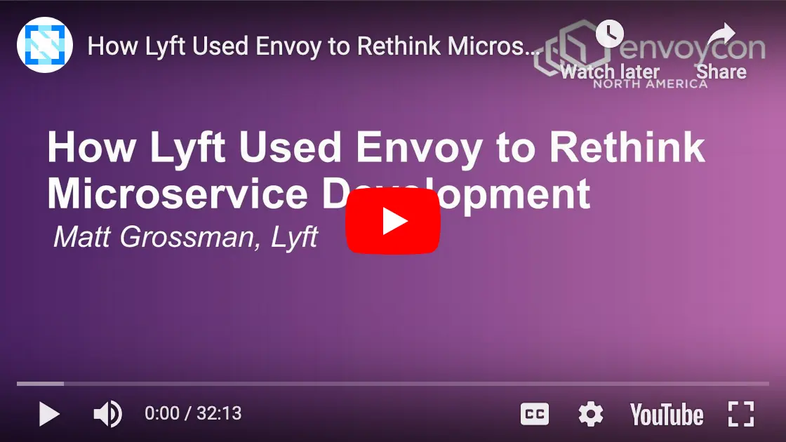

<h1 align="center">MATTHEW GROSSMAN</h1>

Hello, my name is Matt. I'm a staff software engineer with experience leading infrastructure and product teams.

### Experience

I'm currently a software engineer working at [NVIDIA](https://nvidia.com). I previously worked at [Gretel](https://web.archive.org/web/20250602235257/https://gretel.ai/), a privacy and synthetic-data company which was acquired by NVIDIA. While at Gretel, I worked on the backend infrastructure for [Gretel Navigator](https://web.archive.org/web/20250630150126/https://gretel.ai/navigator), a compound-AI system for generating synthetic tabular data.

Before Gretel, I was an infra/platform SWE working on the Developer Experience team at Lyft.
We worked with our sibling infra teams to ensure product engineers could be as efficient and safe as possible before pushing to production.
You can read more about this work in our [blog series](https://eng.lyft.com/scaling-productivity-on-microservices-at-lyft-part-3-extending-our-envoy-mesh-with-staging-fdaafafca82f), or watch my presentation from _EnvoyCon 2022_ ([recording](https://www.youtube.com/watch?v=p9dYr23MVv0), [abstract](https://envoyconna22.sched.com/event/1AO5k), [slides](assets/envoycon2022.pdf))

While at Lyft, I also worked on our observability team (tracing, logging, metrics, dashboards) and a product team called [Express Drive](https://www.lyft.com/expressdrive).

I've had internships at Facebook (iOS), Google (Unified Notifications), and Etsy (Promoted Listings).

You can view my full resume at [mrgrossman.com/resume](resume.md)

### Education
After high school in LA, I attended the University of Michigan for a BSE in Computer Science.

While studying at Michigan, I was involved with the [Solar Car Team](https://www.solarcar.engin.umich.edu), [Eta Kappa Nu](https://hkn.ieee.org/hkn-chapters/all-chapters/beta_epsilon), and TAing for [EECS 485 (Web Systems)](https://eecs485staff.github.io/eecs485.org).
